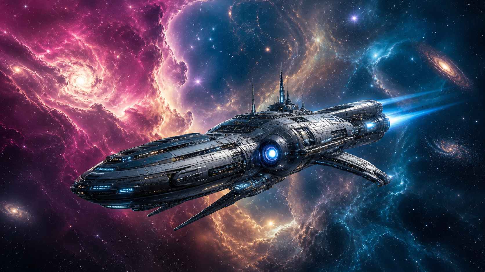
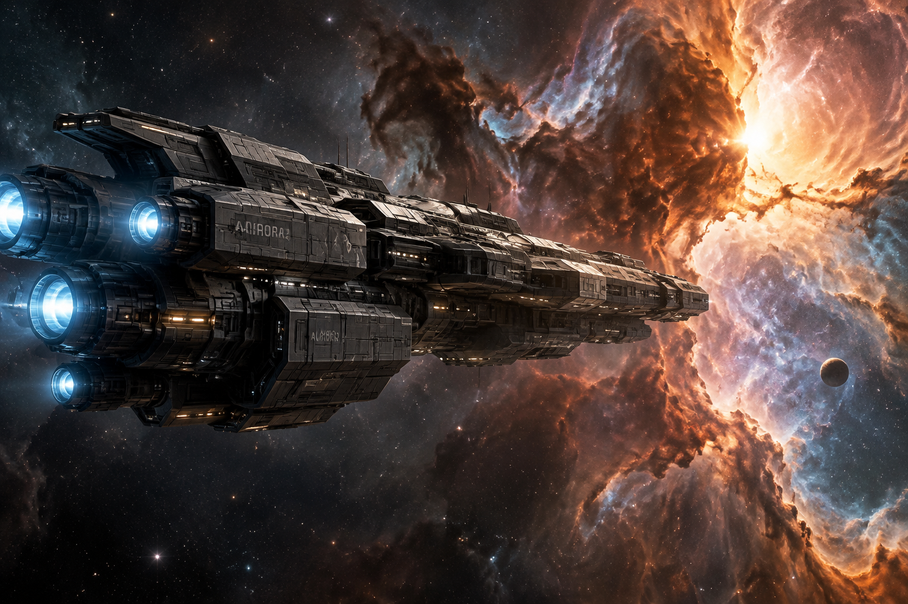
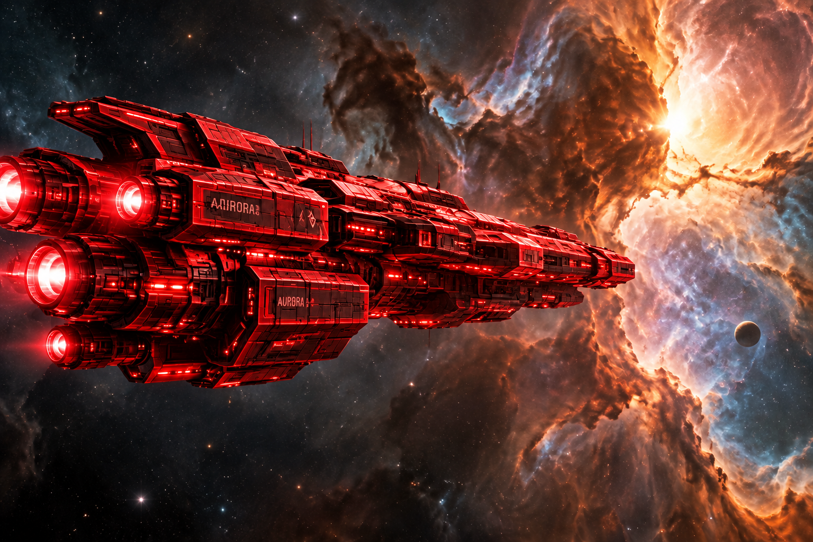

# 🤖 OpenAI API Playground 🚀

Hey everyone! 👋

I recently experimented with the **OpenAI API using Python** and explored some cool things we can build with AI.

From creating my own mini AI assistant to generating futuristic spaceships 🌌, here's what I explored!

## 🎯 What Did I Learn?

- 💬 **AI Text Generation** — Generated responses using AI prompts.
- 📧 **Email Summarization** — Summarized long emails into a few sentences.
- 🧠 **Personal AI Assistant** — Organized AI features using Python OOP.
- 🐾 **Image Understanding** — Experimented with sending images to AI and asking questions.
- 🚀 **Image Generation** — Generated a futuristic spaceship using an AI prompt.
- 🎨 **Image Editing** — Experimented with changing the spaceship's appearance and color.

## 🌌 From Prompt to Spaceship!

One of my favourite experiments was generating a futuristic spaceship and then editing its appearance. Check out the results! 🛸

| 🛸 Original Spaceship | 🚀 Generated Spaceship | 🔴 Red Edition |
|:---:|:---:|:---:|
|  |  |  |

*One prompt, some Python, and a little AI magic! ✨*

## 🛠️ My Toolkit

- 🐍 Python
- 🤖 OpenAI API
- 📓 Google Colab
- 💡 Prompt Engineering

## 💡 My Biggest Takeaway

AI APIs can do much more than answer questions. They let us build assistants, summarize text, understand images, and generate visual content directly from Python.

This was a fun way to get hands-on experience with **Generative AI and API integration**.

## 🔮 What's Next?

More experiments, more code, and hopefully some cool AI projects!

I'm exploring AI, Machine Learning, and Generative AI one project at a time.

**Thanks for stopping by! Keep building, keep learning. 💻🔥**
